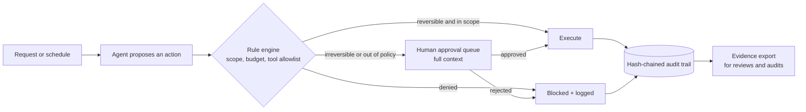

# Governed AI agents (Elite Agentic Solutions): case study

**AI agents a business can audit: every action permissioned, risky actions approved by a person, everything written to a tamper-evident log.**

Designed and built by [Iskra Astudillo](https://github.com/iskra-astudillo) at Elite AI Holdings. This repo documents the product principles. Source is private.

## Problem

Putting an agent near customers, money or data raises three questions that most agent builders cannot answer after the fact:

1. **What did it do?**
2. **Was it allowed to?**
3. **Who signed off when it was unsure?**

Teams either keep agents in demos, or ship them and hope. Regulated teams cannot do either.

## Principles

| Principle | What it means in the product |
|---|---|
| **Permission per action, not per agent.** | Agents run inside a rule engine the business defines: data scoping, spend limits, which tools an agent may call and on what. An agent that is allowed to read invoices is not thereby allowed to pay one. |
| **Irreversible means a human approves.** | Sending money, deleting data, contacting a customer or changing a contract goes to an approval queue with the full context. The agent escalates instead of guessing. |
| **Every action on the record.** | Each action, input and decision is written to a hash-chained, tamper-evident audit trail. Changing an old entry breaks the chain, so the log can be checked rather than trusted. |
| **Budgets are hard limits.** | Spend caps per agent and per task stop a runaway loop before it becomes an invoice. |
| **Fail closed.** | A missing rule, an unreadable policy or an unavailable approver blocks the action. It never defaults to allowed. |
| **Prove the code too.** | A deterministic, zero-LLM scanner checks the code the agents depend on for silent-failure bug classes. A failing scan becomes a failing control. The detector pack is open source: [bugclass-detectors](https://github.com/iskra-astudillo/bugclass-detectors). |

## Architecture

## How I build with agents

The same principles govern how I build software. AI coding agents write most of the code. I write the brief, the acceptance tests and the guards, and I own architecture, review and the decision to ship. Every guard has to be shown failing on a planted bad case before it is trusted, secrets never enter a repository, and anything published goes out from a fresh history after a secret scan.

## What it is not

The software helps a team prepare evidence for SOC 2, ISO 27001 or HIPAA reviews. It is not an auditor and does not certify compliance.

## Status

- Live: https://eliteagenticsolutions.com (interactive demo, no account needed)
- Source: private

## License

Documentation: CC BY 4.0. See [LICENSE](LICENSE).
